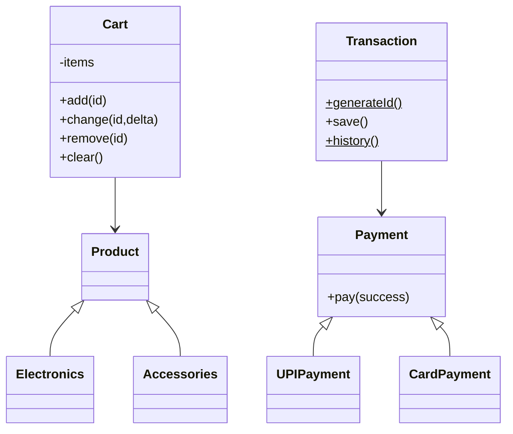
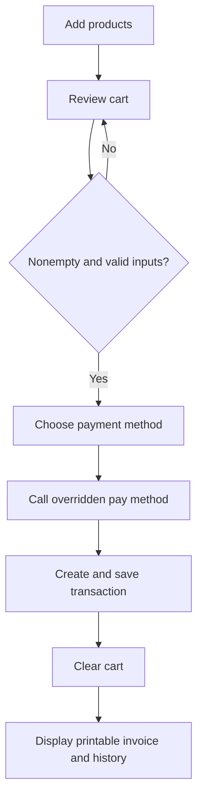

# 7Eleven viva guide

## 1. Introduction
7Eleven is an original electronics concept storefront implemented entirely in the browser.

## 2. Objectives
Demonstrate responsive design, object-oriented JavaScript, persistent cart state and simulated electronic transactions.

## 3. Technologies
HTML provides semantics. Tailwind CSS utility classes provide layout through its CDN. ES6 modules organize JavaScript. LocalStorage preserves JSON across refreshes. No backend processes payments.

## 4. Architecture
HTML loads app.js as a module. It imports product, cart, payment and transaction modules. User events update objects and render the interface. LocalStorage stores cart quantities and transaction snapshots.

## 5. Files
index.html defines the page, Tailwind utility classes, and dialogs. The five files in js/ define products, cart, payment, transactions, and the user interface. assets/images/ holds the actual storefront images.

### Time and space complexity

Let N be the number of catalogue products, C the distinct cart items, K the matching products, and H the number of saved orders. Let S be the serialized history size, including all line items and customer details. Assume bounded product text and search query lengths.

| Operation | Time | Extra space |
|---|---|---|
| Filter and render catalogue and cart | O(N + C) | O(K + C) |
| Filter with price sorting | O(N + C + K log K) on typical engines | O(K + C) on typical engines |
| Change quantity and save cart, before rendering | O(C), including JSON serialization | O(C) |
| Calculate totals from cart rows | O(C) | O(1) |
| Save an invoice and list history | O(S + C + H), excluding cart and catalogue redraw | O(S + C + H) |
| Open one invoice | O(C) for that invoice's line items | O(C) |

For your notebook, trace `render()` for searching, `Cart.change()` for quantity changes, and the checkout submit handler for transactions. CSS, image files, and HTML describe presentation and are separate from these JavaScript operation counts.
Directories and ES modules are the organizational equivalent used here, not Java-style packages.

## 6. Classes and objects
Product defines common product data. Electronics and Accessories are subclasses. Cart manages quantities. Payment defines a common operation. UPIPayment and CardPayment specialize that operation. Transaction stores a payment snapshot.

Actual object creation from app.js:
```js
const cart = new Cart();
```
The product catalogue creates ten objects with explicit calls to `new Electronics(...)` and `new Accessories(...)`. Each object has a real product name, a sample price, and a local product image.

## 7. Inheritance
Actual product.js declarations:
```js
export class Electronics extends Product {}
export class Accessories extends Product {}
```
Their inherited constructor initializes shared data.

## 8. Polymorphism
Both payment subclasses override pay(success). They return different method names and messages. app.js selects a concrete payment object and invokes its pay method through the same variable. The actual object determines behavior at runtime.

## 9. Encapsulation and abstraction
Cart.#items is private. The items getter returns a copy. Methods change state and persist it. Payment.pay throws unless a subclass supplies its implementation; JavaScript has no abstract keyword here, so this is a convention enforced by an exception.

## 10. Static and dynamic components
Navigation, hero, About and footer are static HTML. Products, search, filters, sorting, quantities, totals, payment results, history and receipts are generated or updated at runtime.

## 11. Static methods and dispatch
Transaction.generateId() belongs to the class and uses crypto.randomUUID(). No transaction instance is required to call it. Cart.add(), change(), remove() and clear() act on individual instances. Runtime dispatch selects UPIPayment.pay or CardPayment.pay.

## 12. E-Transaction workflow
Select products, review bag, validate customer inputs, select a payment method, invoke pay(true), create a transaction ID and timestamp, save the invoice locally, clear the cart and display the invoice. Demo tax is 18%; no real financial transaction occurs.

## 13. UML


## 14. Transaction flow


## 15. Twenty viva questions
1. What is a class? A definition of data and behavior.
2. What is an object? An instance created with new.
3. What is inheritance? Reuse of a parent class through extends.
4. Which classes inherit Product? Electronics and Accessories.
5. What is polymorphism? A common operation with type-specific behavior.
6. Where is overriding? The payment subclasses implement pay.
7. What is encapsulation? Controlled access to private state.
8. Which field is private? Cart.#items.
9. What is abstraction? A shared interface that hides implementation details.
10. Is Payment formally abstract? No; its base method throws.
11. What is static? A member called on the class.
12. Which method generates IDs? Transaction.generateId.
13. What is runtime dispatch? Method selection using the actual object's class.
14. What is a module? A file with imports and exports.
15. Are these Java packages? No, JavaScript modules organize this project.
16. Why LocalStorage? Persistence without a backend.
17. How are objects stored? JSON serialization.
18. What happens after a valid demo checkout? Payment is approved, the invoice is stored locally, and the cart is cleared.
19. Are payments real? No, both methods are simulations.
20. Why use a local server? Browser module loading requires an HTTP origin.

## 16. Conclusion
The project connects simple classes, browser events, persistent state and simulated transactions. It demonstrates frontend OOP without server architecture. Production payment processing would require a different trusted system.

